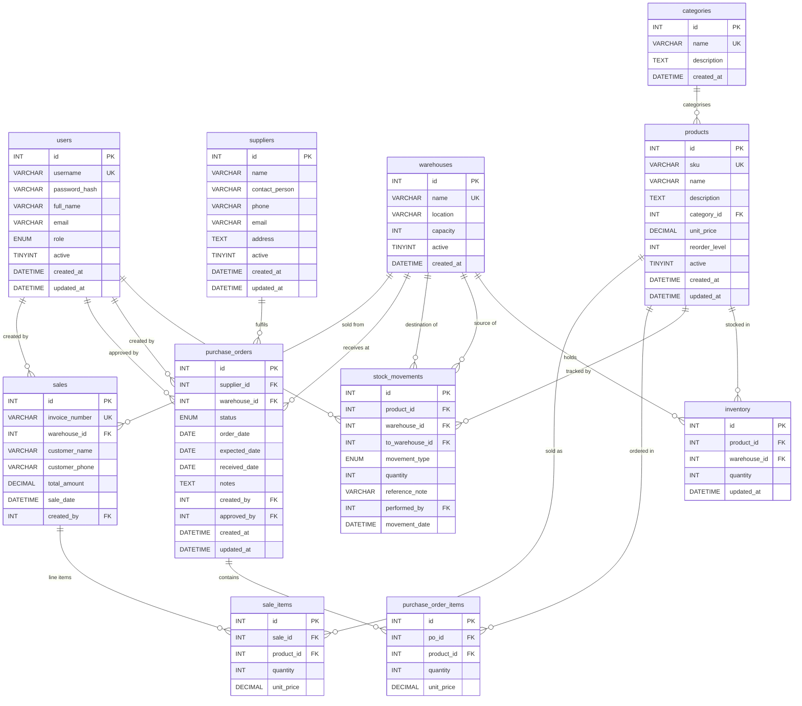

# Inventory Management System — Entity-Relationship Diagram

## Table Summary

| Table | Purpose | Key Constraints |
|---|---|---|
| `users` | System users with roles | `username` UNIQUE; BCrypt password |
| `categories` | Product category lookup | `name` UNIQUE |
| `suppliers` | Supplier master | Soft-delete via `active` flag |
| `warehouses` | Physical warehouse locations | `name` UNIQUE; `capacity >= 0` |
| `products` | Product catalogue | `sku` UNIQUE; `unit_price >= 0`; `reorder_level >= 0` |
| `inventory` | Current stock per product × warehouse | `(product_id, warehouse_id)` UNIQUE; `quantity >= 0` |
| `stock_movements` | Immutable audit log of all stock changes | `quantity > 0`; FK to `to_warehouse_id` for TRANSFER |
| `purchase_orders` | PO header (supplier → warehouse) | Status enum: PENDING→APPROVED→RECEIVED / REJECTED |
| `purchase_order_items` | Line items on a PO | `quantity > 0`; cascades on PO delete |
| `sales` | Sales transaction header | `invoice_number` UNIQUE |
| `sale_items` | Line items on a sale | `quantity > 0`; cascades on sale delete |

## Design Decisions

- **`inventory` table** is the single source of truth for current stock. `StockService` always updates this table within a transaction alongside inserting a `stock_movements` record.
- **`stock_movements` are immutable** — records are never deleted or updated. Reversals are done by recording an opposite-direction movement.
- **`to_warehouse_id`** on `stock_movements` is only populated for `TRANSFER` type; NULL for IN/OUT/AUDIT.
- **Soft deletes** on `users`, `suppliers`, and `warehouses` via the `active` flag to preserve referential integrity.
